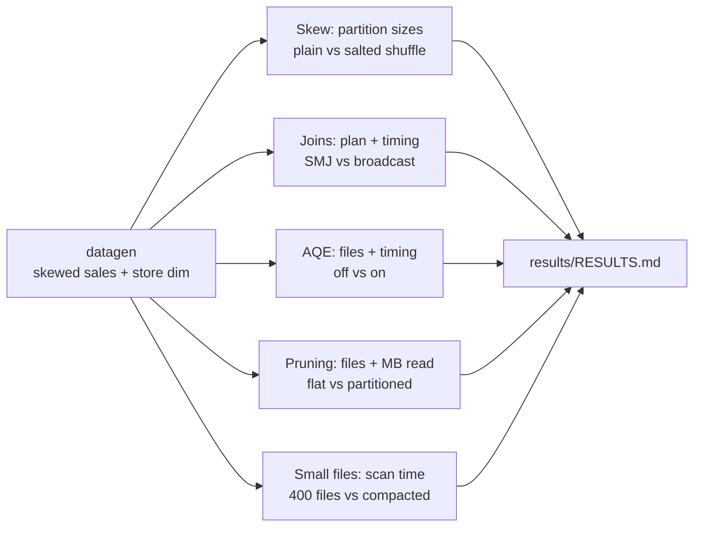

# Spark Performance Tuning Lab


 

Reproducible experiments that measure the Spark optimizations I use on production Databricks jobs: **skew salting, broadcast joins, Adaptive Query Execution, partition pruning, and small-file compaction**. Every number in [`results/RESULTS.md`](results/RESULTS.md) is produced by running the code in this repo.

## Results summary

Measured on 2 million synthetic sales rows where one store holds ~40% of the data (see full details in [`results/RESULTS.md`](results/RESULTS.md)):

| Optimization | Before | After | Impact |
|---|---|---|---|
| **Salting a skewed key** | Largest shuffle partition 862,355 rows (11.6x median) | 186,936 rows (1.5x median) | Straggler task input cut by **78%** |
| **Broadcast join** | SortMergeJoin, 2 shuffles, 1.83s | BroadcastHashJoin, 0 shuffles, 0.59s | **68% faster** |
| **AQE partition coalescing** | 200 output files, 12.6s | 1 output file, 1.34s | **89% faster** |
| **Partition pruning** | 16 files / 21.4 MB read, 0.42s | 1 file / 0.3 MB read, 0.15s | **64% faster** |
| **Compaction (OPTIMIZE)** | 400 small files, 1.06s scan | 4 files, 0.26s scan | **75% faster** |

> Honest note: these runs used a single-core machine. File counts, bytes read, and partition sizes are hardware-independent, but timings are not. Salting, for example, is slightly *slower* on one core (the work is the same, just split up) and only pays off on a cluster where many cores would otherwise sit idle waiting for the one overloaded task. Re-run the lab on your own cluster for representative timings.

## How each experiment works



- **Skew** is measured the way a shuffle actually distributes rows: hash-partition by the join key and count rows per partition, before and after adding a salt to the hot key.
- **Joins** are checked by inspecting the physical plan (`SortMergeJoin` vs `BroadcastHashJoin`, number of shuffle exchanges), not just timing.
- **AQE** runs the same aggregation with `shuffle.partitions=200` and counts the output files with AQE on and off.
- **Pruning** records exactly which files the query reads and how many MB.

## Reusable code

`src/perf_lab/salting.py` is production-ready:

```python
from perf_lab.salting import find_hot_keys, salted_join, salted_aggregate

hot = find_hot_keys(sales, "store_id", threshold_share=0.05)       # e.g. [0]
joined = salted_join(sales, stores, "store_id", buckets=16, hot_keys=hot)
totals = salted_aggregate(sales, "store_id", "amount", buckets=16)  # two-phase aggregation
```

Only hot keys are salted, so the dimension side grows by `buckets` rows per hot key instead of being fully exploded. Tests prove salted results exactly match the plain join and aggregation.

## Run it

Requires Python 3.10+ and Java 17.

```bash
pip install -r requirements.txt
PYTHONPATH=src USE_DELTA=0 python -m perf_lab.experiments --rows 2000000 --out results
pytest -q
```

Try `--rows 20000000 --hot-share 0.6` on a bigger machine or a Databricks cluster.

## Also in this repo

- [`TUNING_CHECKLIST.md`](TUNING_CHECKLIST.md): the order I work through when a Databricks job is slow.
- [`databricks/delta_maintenance.sql`](databricks/delta_maintenance.sql): OPTIMIZE / Z-ORDER, auto-compaction, and VACUUM.

## Tech stack

PySpark · Spark SQL · Adaptive Query Execution · Delta Lake · Databricks · pytest · GitHub Actions
